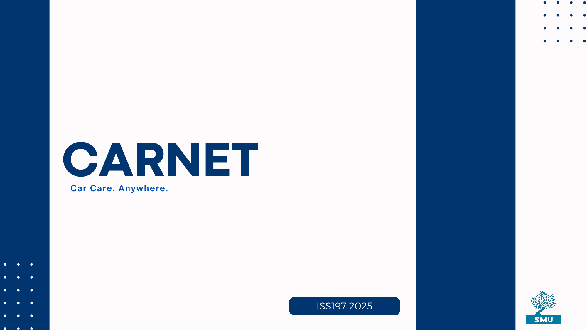
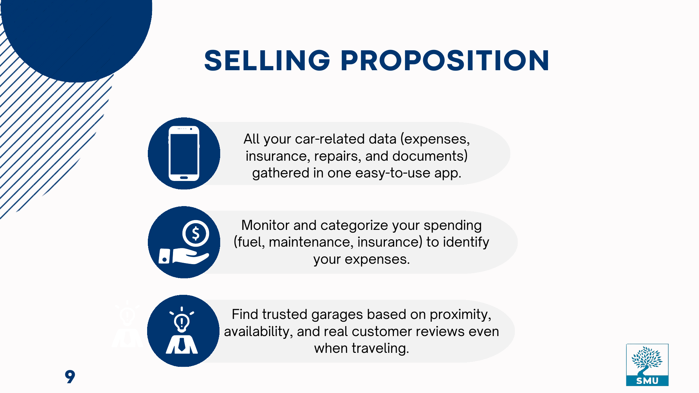
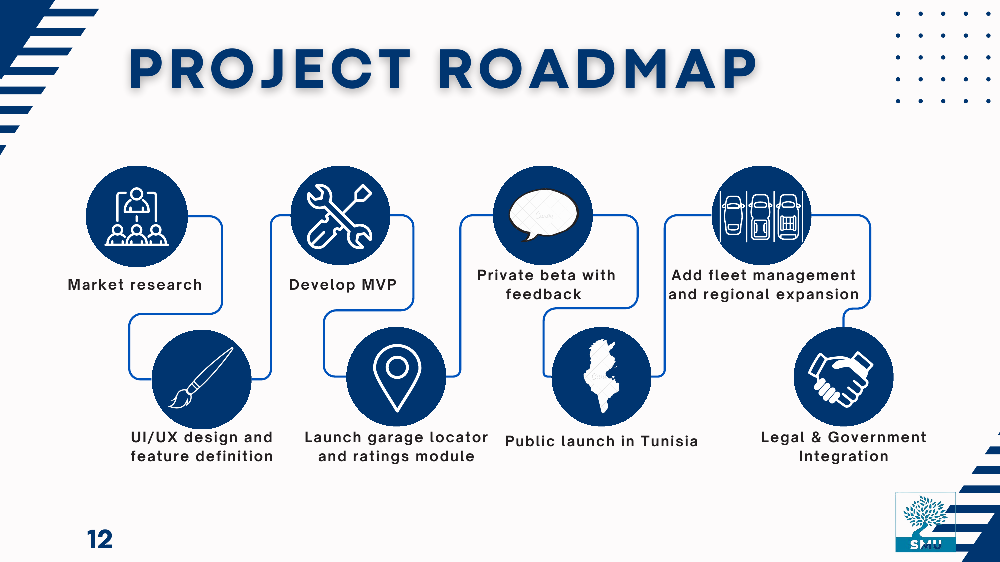

# 🚗 Carnet: Car Care. Anywhere.

**Carnet** is a startup concept for a car-management app aimed at Tunisian drivers. It brings all of a car's data (expenses, insurance, repairs, documents) into one app, tracks spending by category, sends maintenance reminders, and helps drivers find trusted garages nearby, even while travelling.

Entrepreneurship & innovation project (ISS197) at MedTech – South Mediterranean University, built by a team of 5.

## The problem

- Most car owners in Tunisia don't track their car expenses well
- There is no single platform for car-related information
- It's hard to find a trustworthy garage nearby, especially when travelling

## The solution

- **One place for everything:** expenses, insurance, repairs and documents
- **Spending analytics:** categorise fuel, maintenance and insurance costs
- **Garage finder:** trusted garages ranked by proximity, availability and real reviews
- **Business model:** freemium

## Process

1. **Opportunity screening:** two ideas (GreenBin, a recycling app, and Carnet) were scored with a feasibility "first screen" covering idea strength, market timing, added value, competition and risks with mitigations. Carnet scored higher (18 vs 17). See [`docs/opportunity-screening.xlsx`](docs/opportunity-screening.xlsx).
2. **Market study:** about 2.1 M cars in Tunisia (2025), an automotive service sector worth about 1.2 B TND, and about 6,500 licensed garages. With 7 % early adoption, that's roughly 147 K potential users.
3. **Target audience:** private car owners, users who struggle to track expenses, and businesses with vehicle fleets.
4. **Roadmap:** MVP → private beta → garage locator & ratings → fleet management → public launch in Tunisia.

## Skills used

Design thinking · market research · feasibility analysis · business modelling · pitching

📊 [Full pitch deck](docs/pitch-deck.pdf)

## Team

Amine Ben Nasrallah · Adem Arroum · Asser Hermassi · Houssem Rafraf · Aziz Mezrioui
